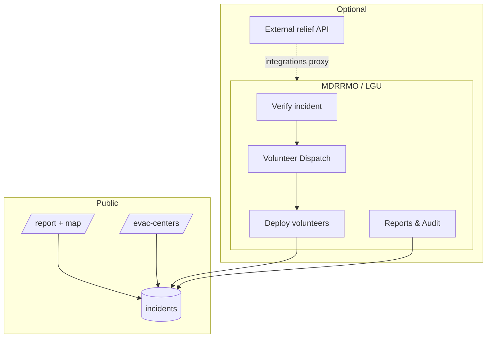
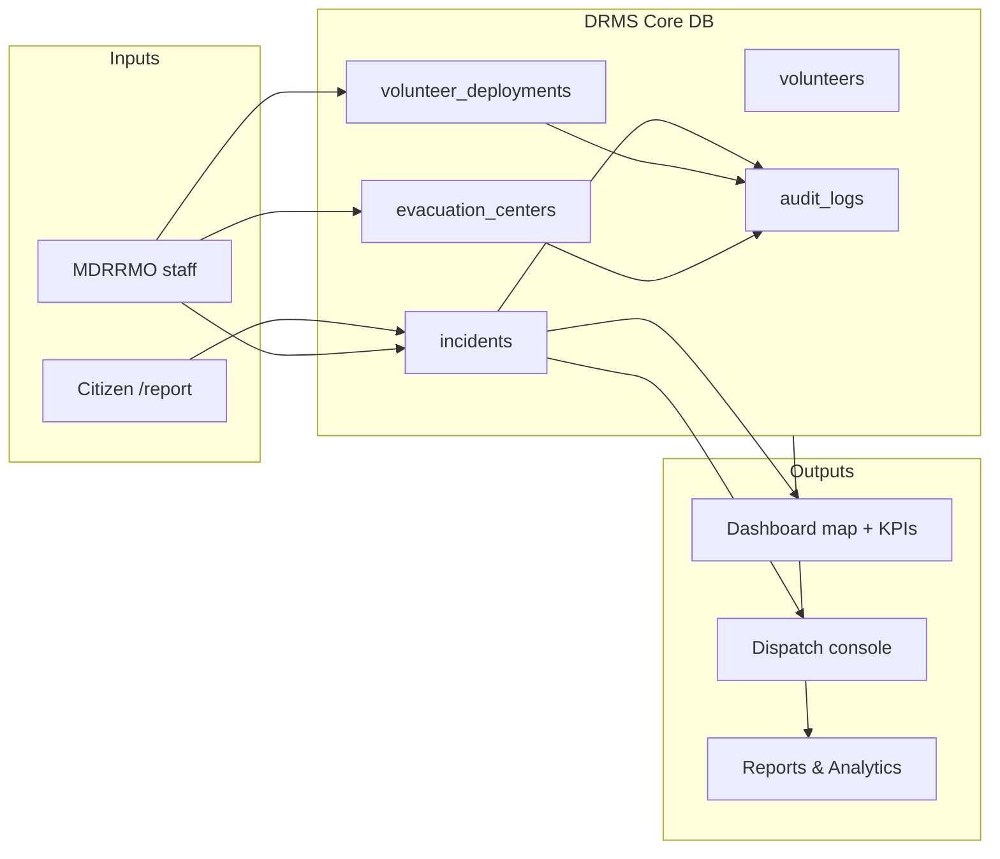

# DRMS – Architecture & Technical Documentation

**Disaster Response & Volunteer Matching System** for the Municipality of Baras, Rizal (Philippines).

This document describes architecture, code layout, frontend–backend connection, security, libraries, database, and key operational flows. For **ERP two-module strategy**, see [`ERP-INTEGRATION-STRATEGY.md`](ERP-INTEGRATION-STRATEGY.md). For **Group 2 relief integration**, see [`API-INTEGRATION.md`](API-INTEGRATION.md).

---

## Table of Contents

1. [Purpose & Overview](#1-purpose--overview)
2. [ERP Two-Module Platform](#2-erp-two-module-platform)
3. [Architecture Overview](#3-architecture-overview)
4. [Project Structure](#4-project-structure)
5. [How the Code Works](#5-how-the-code-works)
6. [Frontend–Backend Connection](#6-frontendbackend-connection)
7. [Security](#7-security)
8. [Libraries & Tools](#8-libraries--tools)
9. [Database](#9-database)
10. [Key Flows](#10-key-flows)
11. [Endpoints & Connections](#11-endpoints--connections)
12. [System Flow by Role](#12-system-flow-by-role)
13. [Data Flow Across Roles](#13-data-flow-across-roles)

---

## 1. Purpose & Overview

**DRMS** is the response & volunteer core. A separate relief & logistics codebase handles donations, inventory, and (target) evacuation ownership; both integrate via REST and shared master data.

| Area | In-app capability | ERP group |
|------|-------------------|-----------|
| **Incidents** | Public + admin reporting, verification, GIS map, severity/priority | G1 |
| **Volunteers** | Registry, skills, ID verification, **skill-aware dispatch** | G1 |
| **Evacuation** | Center CRUD, capacity, public registration — **bridge until G2 cutover** | G2 bridge |
| **Users** | Registration (resident-first), admin approval, role assignment | Shared |
| **Reports** | Live analytics, Chart.js dashboards, PDF/Excel export | G1 |
| **Audit** | Append-only activity log with filters, timeline, CSV export | Shared |
| **Relief** | **Not in core UI** — REST proxy to Group 2 relief service | G2 |

### Roles (CodeIgniter Shield groups)

| Role | Typical access |
|------|----------------|
| **admin** | Full system |
| **mdrrmo** | MDRRMO / LGU staff — incidents, volunteers, matching, evacuation, reports, users |
| **evac_manager** | Evacuation centers |
| **volunteer** / **donor** | Limited portal dashboard |
| **resident** | Public profile after self-registration (no `admin.access` until promoted) |

### Public surface

- Homepage: carousel, modules, **Windy** weather map, **Open-Meteo** conditions (proxied via `/api/weather/current`)
- **`/report`** — citizen incident form with **Leaflet map picker** (no manual lat/long required)
- **`/evac-centers`** — shelter list + **Leaflet map**, nearest center, family registration
- **`/register`** — email + password; new users start as **resident**
- **`/profile`** — account, volunteer skills, ID upload (when applicable)

Primary coordinates: **14.5171, 121.2672** (Baras, Rizal) — `app/Config/Drms.php`

---

## 2. ERP Two-Module Platform

```
┌────────────────────────────── DRMS platform ──────────────────────────────────┐
│  DRMS — operations (this repo)       │  Relief & logistics (partner repo)   │
│  Incidents · Volunteers · Dispatch     │  Relief · Donations · Inventory      │
│  Tasks · G1 dashboard                  │  Evacuation (target) · G2 dashboard  │
└──────────────────┬─────────────────────┴──────────────────┬────────────────┘
                   │         REST JSON · shared incident ID      │
                   └──────────────────┬──────────────────────────┘
                                      ▼
              users · roles · notifications · inventory · audit_logs
```

- **Config:** `app/Config/Drms.php` — `erpModuleGroup1`, `erpModuleGroup2`, `erpIntegratedWorkflow`, `erpRoleAccessMatrix`
- **Public UI:** homepage modules section, [About page](../app/Views/home/about.php)
- **Relief proxy:** `ExternalReliefApiClient` → Group 2 when `integrations.reliefApiEnabled`

Full strategy: [`ERP-INTEGRATION-STRATEGY.md`](ERP-INTEGRATION-STRATEGY.md).

---

## 3. Architecture Overview

Single **CodeIgniter 4** application — HTML views and JSON endpoints share one codebase and `public/index.php` entry point.

```
┌─────────────────────────────────────────────────────────────────────────────┐
│                    DRMS (CodeIgniter 4 — single application)                 │
│                                                                              │
│  ┌──────────────────────────┐    ┌──────────────────────────────────────┐ │
│  │  PUBLIC LAYER            │    │  ADMIN LAYER (AdminLTE 3)            │ │
│  │  Home, Report, Evacuation│    │  Dashboard, Incidents, Volunteers,   │ │
│  │  Register, Profile       │    │  Volunteer Dispatch, Evacuation,     │ │
│  │  Bootstrap 4 + Leaflet   │    │  Users, Reports & Analytics, Audit   │ │
│  └──────────────────────────┘    └──────────────────────────────────────┘ │
│                    │                              │                          │
│                    └──────────────┬───────────────┘                          │
│                                   ▼                                          │
│  ┌─────────────────────────────────────────────────────────────────────────┐ │
│  │  SERVICES LAYER                                                         │ │
│  │  IncidentService · IncidentGeoService · VolunteerMatchingService        │ │
│  │  VolunteerDeploymentService · EvacuationLookupService · ReportsAnalytics  │ │
│  │  AuditTrailService · NotificationService · AlertsService · …          │ │
│  └─────────────────────────────────────────────────────────────────────────┘ │
│                                   │                                          │
│  ┌────────────────────────────────┴────────────────────────────────────────┐ │
│  │  REST API — App\Controllers\Api\V1\*                                  │ │
│  │  /api/v1/health (public) · /api/v1/incidents/report (public POST)       │ │
│  │  /api/v1/* (protected) · /api/v1/integrations/relief/* (proxy)        │ │
│  └─────────────────────────────────────────────────────────────────────────┘ │
└─────────────────────────────────────────────────────────────────────────────┘
                                    │
                                    ▼
┌─────────────────────────────────────────────────────────────────────────────┐
│                         MySQL (drms_db) + Shield auth tables                 │
└─────────────────────────────────────────────────────────────────────────────┘
                                    │
          ┌─────────────────────────┼─────────────────────────┐
          ▼                         ▼                         ▼
   Open-Meteo (weather)      Windy embed (map)      External relief API
   via server proxy           browser iframe         (optional, .env)
```

**Design choices**

- **Monolith MVC** — no separate SPA/API server; admin uses jQuery AJAX to same-origin routes.
- **Geo resolution** — `IncidentGeoService` resolves coordinates: incident GPS → barangay center → municipal office.
- **Relief decoupled** — inventory/distributions live in a **separate system**; DRMS exposes proxy endpoints when `integrations.reliefApiBaseUrl` is configured (see `API-INTEGRATION.md`).
- **Maps** — **Leaflet** + OpenStreetMap on dashboard, public report, public/admin evacuation, volunteer dispatch.

---

## 4. Project Structure

```
drms/
├── public/
│   ├── index.php
│   └── assets/
│       ├── adminlte/              # AdminLTE 3 + jQuery, DataTables, Chart.js, …
│       ├── css/
│       │   ├── public-home.css
│       │   └── drms-admin.css
│       └── js/
│           ├── public-home.js
│           └── drms-admin.js        # CSRF, DataTables, CRUD, toasts
│
├── app/
│   ├── Config/
│   │   ├── Routes.php
│   │   ├── Drms.php                 # App branding, Baras coords, map zoom
│   │   ├── DrmsFeatures.php         # Incident types, skills, staffing defaults
│   │   ├── Integrations.php         # External relief API settings
│   │   ├── AuthGroups.php           # Roles & permissions
│   │   └── Filters.php              # CSRF, Shield, DrmsPortalFilter
│   │
│   ├── Controllers/
│   │   ├── Home.php
│   │   ├── Public/
│   │   │   ├── Report.php           # /report
│   │   │   └── Evacuation.php       # /evac-centers
│   │   ├── Auth/                    # Register, Login, PendingApproval
│   │   ├── Admin/
│   │   │   ├── Dashboard.php
│   │   │   ├── Incidents.php
│   │   │   ├── Volunteers.php
│   │   │   ├── Matching.php         # Volunteer Dispatch console
│   │   │   ├── EvacuationCenters.php
│   │   │   ├── Users.php
│   │   │   ├── Reports.php
│   │   │   └── AuditTrail.php
│   │   └── Api/V1/
│   │       ├── Health.php
│   │       ├── IncidentsApi.php
│   │       ├── VolunteersApi.php
│   │       ├── EvacuationCentersApi.php
│   │       ├── DashboardApi.php
│   │       └── IntegrationsApi.php  # Relief proxy
│   │
│   ├── Services/                    # Business logic (see §4)
│   ├── Models/
│   ├── Views/
│   │   ├── layouts/public.php | admin.php
│   │   ├── home/
│   │   ├── public/report.php, evac_centers.php
│   │   └── admin/                   # dashboard, incidents, matching, …
│   ├── Helpers/
│   │   ├── drms_helper.php          # Map config, incident/evac markers
│   │   ├── crud_helper.php          # Icon action buttons
│   │   └── datatable_helper.php
│   └── Database/
│       ├── Migrations/
│       └── Seeds/DrmsDemoSeeder.php, DrmsTestUsersSeeder.php
│
├── details/
│   ├── ARCHITECTURE.md              # This file
│   ├── API-INTEGRATION.md           # External relief bridge
│   ├── README-DRMS.md
│   └── TEST_ACCOUNTS.md
│
├── .env
└── writable/                        # logs, cache, session, uploads
```

---

## 5. How the Code Works

### 4.1 Layering

| Layer | Responsibility |
|-------|----------------|
| **Controller** | HTTP, validation rules, view/JSON response |
| **Service** | Business rules, orchestration, audit logging |
| **Model** | Database access (CodeIgniter Model) |
| **View** | Server-rendered HTML + page scripts |

### 4.2 Public incident report

1. `GET /report` → `Public\Report::index()` — barangay list + Leaflet map config
2. User selects barangay, taps map or uses GPS → hidden `latitude`/`longitude`
3. `POST /report/submit` → `IncidentService::create()` → `IncidentGeoService::enrichPayload()` if coords missing
4. Media via `IncidentMediaService`; redirect to success page

### 4.3 Admin incident lifecycle

1. DataTables `GET /admin/incidents/data`
2. Create/update/verify/delete via POST endpoints
3. `IncidentClassificationService` sets priority tag + staffing needs from type/severity
4. Dashboard map: `GET /admin/dashboard/incidents-map` (GeoJSON-like features with disaster-type markers)

### 4.4 Volunteer dispatch (matching)

1. `GET /admin/matching?incident_id={id}` — incident queue, staffing bars, top-3 cards, Leaflet map
2. `VolunteerMatchingService::recommendForIncident()` — scores by skills, distance, fatigue, workload
3. Deploy: `POST /admin/matching/deploy` | `deploy-bulk` | `auto-assign`
4. `VolunteerDeploymentService` updates availability, audit log, notification queue

### 4.5 Reports & analytics

1. `ReportsAnalyticsService` aggregates KPIs, 7-day trends, severity/status breakdowns
2. Page auto-refreshes via `GET /admin/reports/analytics`
3. Export: Dompdf (PDF) + PhpSpreadsheet (Excel) via `ReportExportService`

### 4.6 Audit trail

1. `AuditLogService::log()` on mutations (incidents, volunteers, deployments, evacuation)
2. `AuditTrailService` formats rows, filters, timeline, CSV export
3. UI: KPI strip, 14-day chart, table + timeline tabs, detail modal (user, IP, meta JSON)

### 4.7 External relief (optional)

When configured, `IntegrationsApi` proxies to external REST service — see `API-INTEGRATION.md`. No relief tables in core DB after migration `2026-06-11-120000_RemoveReliefAndAiTables`.

---

## 6. Frontend–Backend Connection

### 5.1 Same-origin AJAX

Admin pages use `drms-admin.js`:

| Helper | Purpose |
|--------|---------|
| `DRMS.csrf()` | CSRF from layout meta |
| `DRMS.postForm()` / `postJson()` | POST with CSRF |
| `DRMS.serverDataTable()` | Server-side DataTables |
| `DRMS.bindCrud()` | Modal CRUD wiring |

### 5.2 Leaflet maps

Used on: admin dashboard (incidents), volunteer dispatch, public `/report`, public `/evac-centers`, admin evacuation centers.

Config from `drms_leaflet_map_config()` in `drms_helper.php` (center, zoom, bounds — Baras service area).

### 5.3 Weather

| Feature | Path |
|---------|------|
| Homepage card | Browser → `GET /api/weather/current` → `OpenMeteoService` (server proxy, no CORS) |
| Windy iframe | `windy_embed_url()` in helper — browser loads embed directly |

---

## 7. Security

### 6.1 Authentication (Shield)

- Login: `/login` (email or username + password)
- Registration: `/register` — **resident** group by default; admin approves and assigns roles
- Passwords in `auth_identities` (bcrypt), not plain `users` table

### 6.2 Authorization

- `permission:admin.access` on `admin/*` and protected `api/v1/*`
- `DrmsPortalFilter` — per-route permission checks (e.g. `matching.access`, `audit.*`)
- `BarangayScopeService` — optional incident scope for barangay officials

### 6.3 CSRF

Session CSRF on all state-changing POST requests; meta tag + `X-CSRF-TOKEN` in AJAX.

### 6.4 Demo / presentation mode

- `PresentationModeFilter` — can block writes or serve fixture JSON when offline demo is active
- Public `report/submit` allowed through demo filter (real saves when DB available)

---

## 8. Libraries & Tools

### 7.1 Backend (Composer)

| Package | Purpose |
|---------|---------|
| codeigniter4/framework | MVC, routing, DB, email |
| codeigniter4/shield | Auth, groups, permissions |
| dompdf/dompdf | PDF report export |
| phpoffice/phpspreadsheet | Excel export |

### 7.2 Admin UI (local AdminLTE bundle)

AdminLTE 3, Bootstrap 4, jQuery, DataTables, Chart.js, SweetAlert2, Font Awesome

### 7.3 Maps & public UI

| Library | Where |
|---------|-------|
| **Leaflet 1.9** | CDN on map pages |
| **Lucide** | Public homepage icons (CDN) |
| **DM Sans** | Public typography |

### 7.4 External services

| Service | Use | Key |
|---------|-----|-----|
| Open-Meteo | Current weather | None |
| Windy embed | Weather layers map | None |
| OpenStreetMap tiles | Leaflet basemap | None |
| External relief API | Inventory/distributions proxy | `.env` integrations.* |
| SMTP / mail() | Notification queue | Email config |

---

## 9. Database

### 8.1 Core operational tables

| Table | Purpose |
|-------|---------|
| `users`, `auth_*` | Shield authentication |
| `barangays` | Reference + lat/lng for geo |
| `incidents` | Reports (type, priority, staffing needs, coords) |
| `incident_media` | Upload metadata |
| `volunteers`, `volunteer_skills` | Registry + skills |
| `volunteer_deployments` | Deployments to incidents |
| `evacuation_centers` | Shelters, capacity, families count |
| `evac_families` | Family registration at centers |
| `notification_queue` | Outbound notifications |
| `audit_logs` | Append-only audit (`user_id`, `action`, `meta_json`, `ip_address`) |
| `donors`, `donations` | Optional donations module (data model retained) |

### 8.2 Removed from core (migration 2026-06-11)

Dropped tables (relief/AI handled externally or removed from scope):

- `relief_items`, `relief_distributions`
- `ai_suggestions`, `chatbot_messages`, `social_media_flags`

Related audit rows for those entity types are purged by the same migration.

### 8.3 Setup

```bash
php spark migrate --all
php spark db:seed DrmsDemoSeeder
php spark db:seed DrmsTestUsersSeeder
```

---

## 10. Key Flows

### 9.1 Citizen reports flood (public)

```
/report → map pin + barangay → POST report/submit
  → IncidentService::create()
  → IncidentGeoService::enrichPayload()
  → audit + optional notification
  → visible on admin dashboard map (status: reported)
```

### 9.2 MDRRMO verifies and dispatches volunteers

```
/admin/incidents → Verify
  → /admin/matching?incident_id=X
  → ranked volunteers + map
  → Deploy / Auto-assign team
  → VolunteerDeploymentService
  → audit: volunteer.deploy
```

### 9.3 Evacuation during typhoon

```
Public /evac-centers → map + nearest API
Admin /admin/evacuation-centers → capacity cards + map
  → update occupancy / status
  → dashboard evacuation occupancy alert
```

### 9.4 Compliance review

```
/admin/audit-trail → filter by module/user/date
  → timeline or table
  → detail modal (IP + JSON meta)
  → export CSV
```

---

## 11. Endpoints & Connections

### 10.1 Public routes (pages & APIs)

| Route | Controller | Purpose |
|-------|------------|---------|
| `/` | `Home::index` | Landing |
| `/about` | `Home::about` | About |
| `/report` | `Public\Report` | Incident form + map |
| `/evac-centers` | `Public\Evacuation` | Shelters + map |
| `/register`, `/login` | Auth | Account |
| `/profile/*` | `Profile` | User portal |
| `GET /api/weather/current` | `Home::weatherCurrent` | Weather JSON |
| `GET /api/evac/nearest` | `Public\Evacuation::nearestApi` | Nearest shelter |
| `POST /api/v1/incidents/report` | `IncidentsApi::publicReport` | API incident report |

### 10.2 Admin routes (selected)

| Area | Key routes |
|------|------------|
| **Dashboard** | `dashboard`, `dashboard/live`, `dashboard/incidents-map`, `incidents-heatmap`, `incidents-chart` |
| **Incidents** | CRUD + `verify`, `media` |
| **Volunteers** | CRUD + `verify-id`, `reject-id` |
| **Volunteer Dispatch** | `matching`, `matching/deploy`, `deploy-bulk`, `auto-assign` |
| **Evacuation** | CRUD + `summary`, `families` |
| **Users** | CRUD + `approve`, `reject` |
| **Reports** | `reports`, `reports/analytics`, `reports/export/{type}` |
| **Audit** | `audit-trail`, `data`, `summary`, `timeline`, `show/{id}`, `export` |

### 10.3 Protected REST API (`/api/v1`)

| Method | Endpoint | Purpose |
|--------|----------|---------|
| GET | `/health` | Liveness (public) |
| POST | `/incidents/report` | Public report (see above) |
| GET | `/auth/me` | Current user + roles (any auth) |
| GET | `/roles` | Role & permission catalog |
| GET | `/users` | User roster (`users.*`) |
| GET | `/users/{id}` | User detail |
| GET | `/stats` | Dashboard KPIs |
| GET | `/incidents` | List incidents |
| POST | `/incidents` | Create incident |
| GET | `/volunteers` | List volunteers |
| GET | `/evacuation-centers` | List centers |
| GET | `/evacuation-centers/{id}` | Center detail |
| GET | `/integrations/relief/status` | External relief bridge |
| GET | `/integrations/relief/inventory` | Proxy inventory |
| GET | `/integrations/relief/distributions` | Proxy distributions |

Full relief integration contract: **`details/API-INTEGRATION.md`**.  
Shared auth, users, roles: **`details/API-AUTH.md`**.

### 10.4 Admin module → primary services

| Module | Services |
|--------|----------|
| Dashboard | `DashboardStatsService`, `AlertsService`, `IncidentGeoService` |
| Incidents | `IncidentService`, `IncidentClassificationService`, `IncidentDataTableService` |
| Volunteer Dispatch | `VolunteerMatchingService`, `VolunteerDeploymentService` |
| Evacuation | `EvacuationCenterService`, `EvacuationLookupService`, `EvacFamilyService` |
| Reports | `ReportsAnalyticsService`, `ReportExportService` |
| Audit | `AuditTrailService`, `AuditLogService` |
| Users | `UserManagementService`, `UserRegistrationService` |

---

## 12. System Flow by Role

### MDRRMO / LGU Staff / Admin

Full operations: incidents, verify, volunteer dispatch, evacuation, users, reports, audit (admin has full system config).

### Resident (public)

Register → profile → may be promoted to volunteer or staff by admin.

### Volunteer (portal)

Limited dashboard; deployments triggered by staff via matching module.



---

## 13. Data Flow Across Roles



### Entity summary

| Entity | Created by | Consumed by |
|--------|------------|-------------|
| Incidents | Public report, admin | Dashboard map, matching, reports |
| Volunteer deployments | Matching deploy | Audit, notifications |
| Evacuation centers | Admin CRUD | Public map, reports snapshot |
| Audit logs | Services on mutation | Audit trail UI (read-only) |

---

## Quick Reference

| Item | Location |
|------|----------|
| Base URL | `.env` → `app.baseURL` |
| Map & municipality config | `app/Config/Drms.php` |
| Incident types & skills | `app/Config/DrmsFeatures.php` |
| Relief API config | `app/Config/Integrations.php`, `.env` |
| Routes | `app/Config/Routes.php` |
| Permissions | `app/Config/AuthGroups.php` |
| External relief docs | `details/API-INTEGRATION.md` |
| Geo resolution | `app/Services/IncidentGeoService.php` |
| Map markers | `drms_incident_map_marker()`, `drms_evac_map_marker()` in `drms_helper.php` |
| AJAX helpers | `public/assets/js/drms-admin.js` |
| Test accounts | `details/TEST_ACCOUNTS.md` |
| WAMP setup | `details/SETUP-WAMP.md` |

---

*DRMS — Municipality of Baras, Rizal · CodeIgniter 4 + Shield + AdminLTE 3 + Leaflet*
